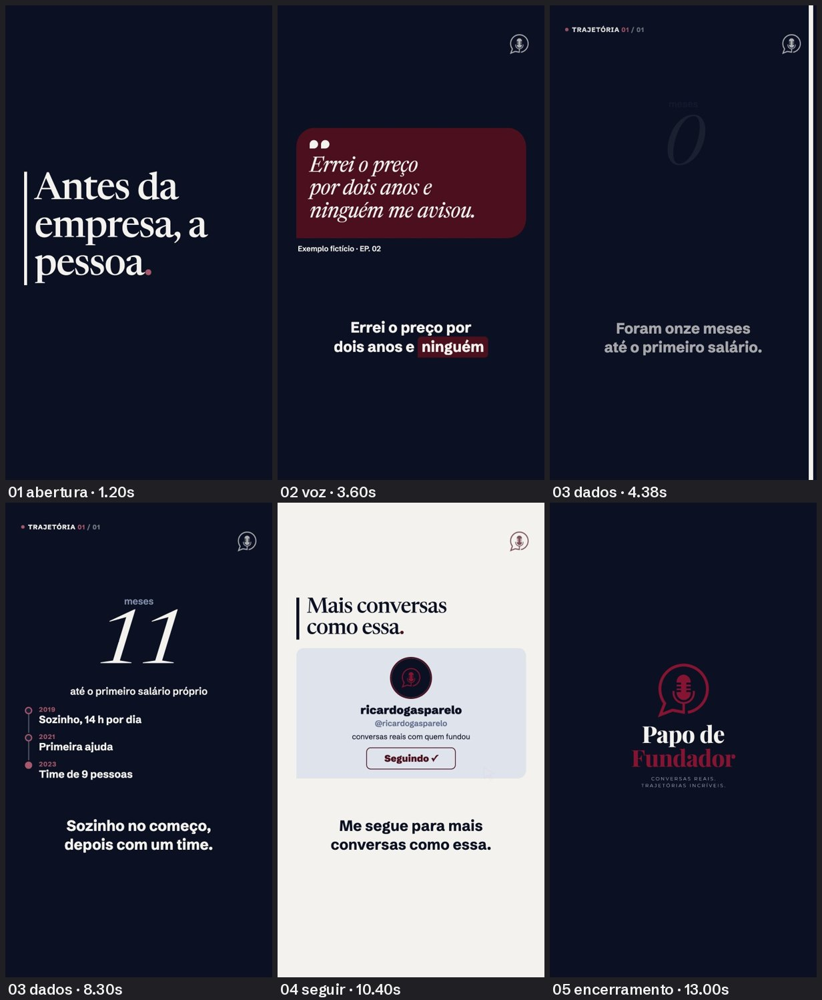
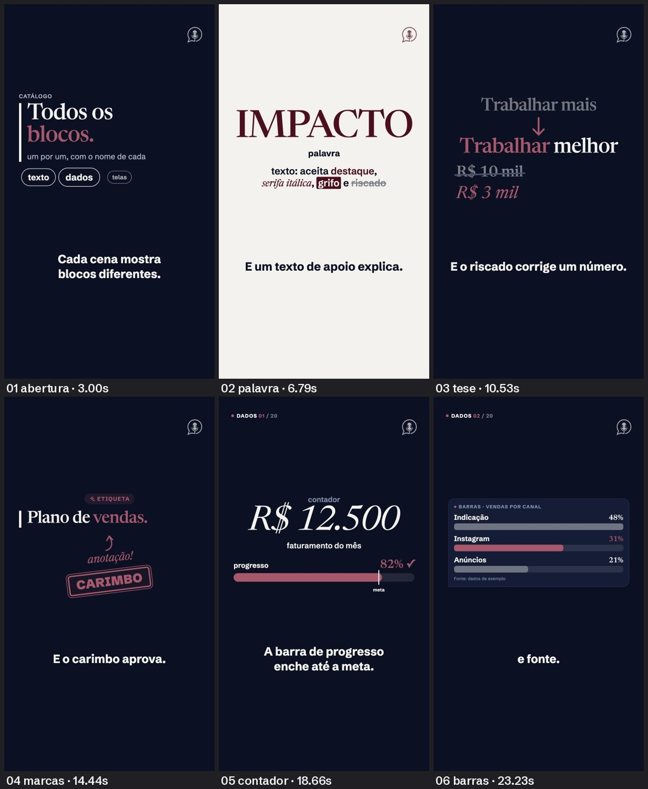

# video-ia — vídeos 100% animados a partir de uma ideia

> Skill do Claude Code que funciona como **diretor, roteirista e editor**: recebe uma ideia, entrevista o autor, escreve o roteiro, recebe a narração gravada e entrega um vídeo vertical pronto para postar, animado do começo ao fim em motion graphics, com conferência de qualidade no final.

**👤 Autor:** Ricardo Gasparelo · [Portfólio](https://githubiogithubio.vercel.app) · [LinkedIn](https://www.linkedin.com/in/ricardo-gasparelo-212381380/)

<p>


</p>

*Quadros de vídeos gerados pela skill: à esquerda, um vídeo com a identidade do Papo de Fundador; à direita, o catálogo de blocos.*

---

## O problema

Vídeos de "motion" para Reels (títulos cinéticos, contadores, gráficos, mocks de celular, CTA) exigem um editor de animação. Para quem produz conteúdo toda semana, isso trava a frequência.

## O que eu construí

```
ideia → ENTREVISTA → ROTEIRO (aprovado) → plano visual → autor GRAVA o áudio → narração limpa → RENDER → conferência → entrega
```

| | |
|---|---|
| **47 tipos de bloco** | títulos cinéticos, palavra de impacto, riscado, contador, barra de progresso, gráficos, linha do tempo, citação, mocks de chat/terminal/celular, diagramas, personagem, CTA de comentário |
| **19 temas visuais** | incluindo o tema da marca Papo de Fundador |
| **Plano em um arquivo** | `plano.json` com as falas e, em cada cena, os blocos ancorados na palavra falada em que aparecem |
| **Narração encaixada** | corta hesitações e tomadas repetidas da gravação e sincroniza cada cena com a voz |
| **Legenda palavra a palavra** | gerada da própria narração |
| **Efeitos sonoros** | sintetizados localmente, sem baixar nada |
| **Conferência automática** | ✔ / ⚠ / ✖ para formato, volume (−14 LUFS), ritmo, sincronia e folha de quadros |

## Decisões que fazem a qualidade

- **3 paradas de aprovação** (entrevista, roteiro, plano visual): texto mudado depois da gravação significa regravar.
- **Estudo de 31 vídeos de referência** para copiar a linguagem de edição, não o conteúdo.
- **Nunca inventar dado:** números com fonte ou aviso de "conteúdo ilustrativo".
- **A voz é do autor.** Testei clonagem de voz com um modelo local; o resultado soou artificial, então o padrão ficou a narração gravada. Saber descartar uma solução também é decisão de produto.

## Tecnologias

`Claude Code (skills)` `Remotion (React)` `TypeScript` `Python` `FFmpeg` `Whisper` `SVG` · roda localmente num Mac M2 de 8 GB

## Skills irmãs

- [skill-video-pessoa](https://github.com/ricardogasparelo/skill-video-pessoa): pessoa falando para a câmera, do roteiro à edição
- [skill-editor-video](https://github.com/ricardogasparelo/skill-editor-video): edição de entrevistas do Papo de Fundador

---

### Sobre o código

Este repositório é a **vitrine** da skill. O código-fonte completo é privado. Para uma demonstração ou acesso ao código, fale comigo no [LinkedIn](https://www.linkedin.com/in/ricardo-gasparelo-212381380/).

© 2026 Ricardo Friedrich Gasparelo. Todos os direitos reservados. Veja [LICENSE](LICENSE).
